# RobotProj

**Modular robot control, from C++ command models to real hardware prototypes.**

RobotProj is an ongoing personal robotics engineering project built around a **Raspberry Pi 5**, independently controlled **ESP32 nodes**, and a custom **Classical CAN command protocol**. The goal is to keep high-level control, message encoding, and low-level actuator firmware separate, so the robot can evolve one subsystem at a time.

**Current milestone:** the C++ application builds on Windows and Linux (x86-64/ARM64); the protocol encoder and stateful sequence decoder are implemented and tested in software. GitHub Actions CI builds and runs CTest on Windows 2022, Ubuntu x86-64 and Ubuntu ARM64. Hardware prototypes for the neck mechanism and cooling control have also been built and tested independently. **End-to-end communication over physical CAN is not implemented yet.**

<p align="center">
  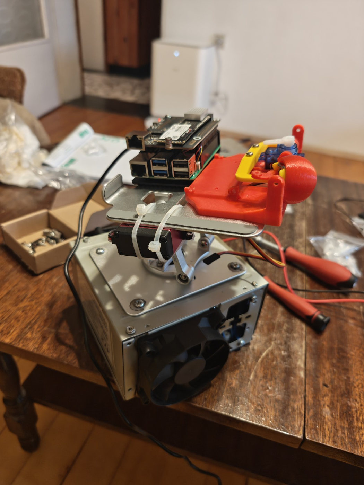
  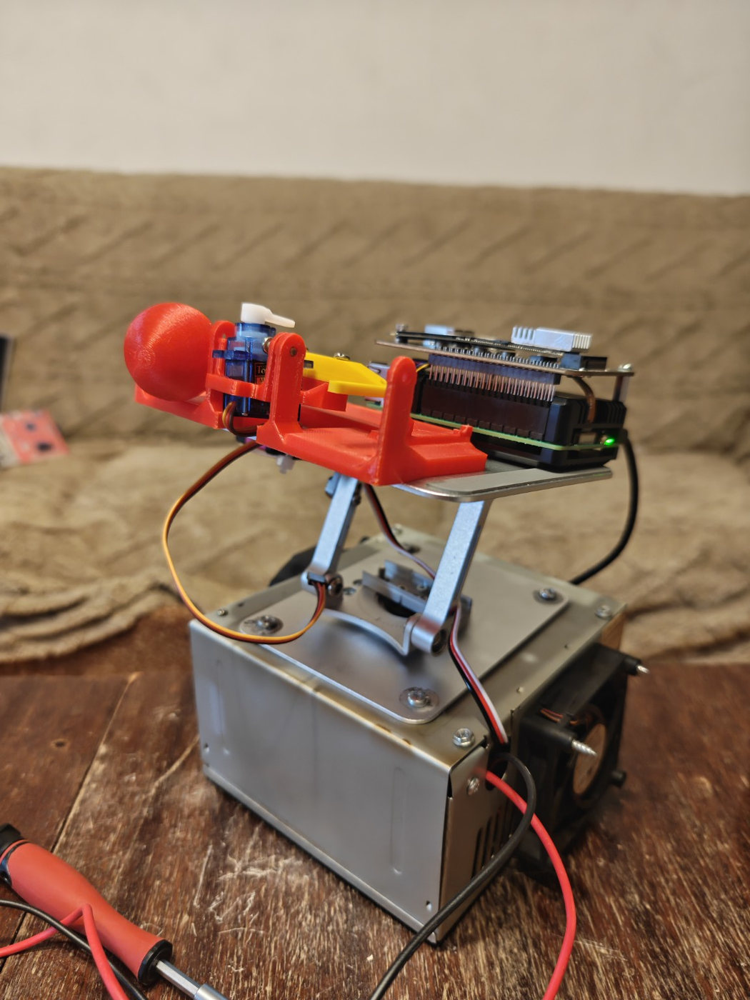
</p>

<p align="center"><em>Hardware iteration in progress — not a finished robot or a production PCB.</em></p>

## At a glance

| Area | Current state |
| --- | --- |
| Host computer | Raspberry Pi 5 (16 GB), Debian 13 ARM64, NVMe SSD — **running** |
| C++ application | Native CMake builds on Windows x64 and Linux ARM64 — **verified** |
| Node models | `HeadNode` / `HeadController` and command payload generation — **implemented in the prototype** |
| Protocol | `CommandEncoder` fragmentation and `CommandDecoder` Single/Sequence reassembly — **implemented and unit-tested in software** |
| Neck hardware | Servo-driven mechanism with experimental ESP32 control — **motion demonstrated** |
| Cooling hardware | ESP32 fan-control prototype with PWM — **bench prototype** |
| Physical CAN transport | Linux `SocketCanTransport` send/receive wrapper implemented; CLI `--can` and end-to-end hardware integration **not yet operational** |
| Reassembly, ACKs and retries | Single/Sequence reassembly **implemented and tested**; ACKs, retries, timeouts and multi-sequence handling **pending** |
| ROS 2, vision and further nodes | **Planned** |

## Hardware demonstration

The current neck test shows actual movement of the prototype mechanism. This is a **standalone hardware demonstration**: the motion is *not* evidence of commands travelling over the future Raspberry Pi → CAN → ESP32 path.

<p align="center">
  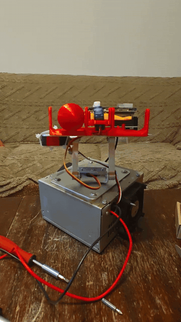
</p>

<p align="center"><a href="docs/media/demos/neck-motion.mp4">Watch the original motion demo (MP4)</a></p>

## System architecture

The system is deliberately layered. Hardware-specific responsibilities should not leak into the command model or the serialization code.

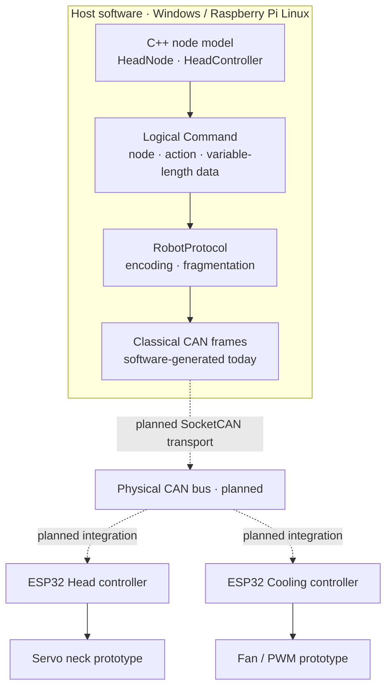

**Separation of responsibilities**

- **Node model:** represents an actuator subsystem and builds a logical command. For example, `HeadNode` stores yaw/pitch values and a bitmask indicating changed targets.
- **Protocol layer:** converts a command into one or more fixed-size Classical CAN frames. A node does **not** decide how many CAN frames are required.
- **Transport layer:** will send and receive physical frames; Raspberry Pi / Linux **SocketCAN** is the intended host interface. It is not integrated into the demonstrated executable yet.
- **ESP32 firmware:** will decode addressed commands, enforce local safety constraints, and drive actuators. The current hardware experiments are a starting point, not a completed distributed CAN system.

## Current C++ implementation

The repository contains the prototype C++ application, including:

- `HeadNode` — a logical head node with yaw/pitch targets, a change mask, and `makeCommand()`.
- `HeadController` — a separate head-control model.
- `Command` and `CanFrame` data types.
- `RobotProtocol` — command encoding and fragmentation into Classical CAN frames.
- A command-line demonstration that prints frame IDs, types, lengths and payload bytes.

Command payloads use a variable-length byte container, while Classical CAN frames hold up to **8 data bytes**. Fragmentation is the protocol's job, not the actuator node's job.

### Sequence fragmentation: verified example

A **19-byte logical payload** is encoded into four frames in the current command-line demonstration:

| Frame | CAN ID | DLC | Payload (hex) |
| --- | --- | ---: | --- |
| `SequenceStart` | `0x9` | 8 | `01 01 00 13 00 01 02 03` |
| `SequenceData` | `0xA` | 8 | `01 01 04 05 06 07 08 09` |
| `SequenceData` | `0xA` | 8 | `01 02 0A 0B 0C 0D 0E 0F` |
| `SequenceEnd` | `0xB` | 5 | `01 03 10 11 12` |

The payload is distributed as **4 + 6 + 6 + 3 = 19 bytes**. The C++ demonstration produced matching frame IDs, data and lengths on Windows x64 and Raspberry Pi Linux ARM64.

> **Scope of validation:** these are frames generated and displayed **in software**. This is not yet a CAN-bus transmission test. Sequence reassembly and end-to-end delivery guarantees remain future work.

## Hardware prototypes

### Head node and neck assembly

A hand-assembled ESP32 controller and a servo-driven neck mechanism form the first physical actuator subsystem. The current prototype is intended to experiment with yaw/pitch control, mechanical mounting and integration constraints.

| Head-node PCB (component side) | Hand-soldered connections |
| :---: | :---: |
| 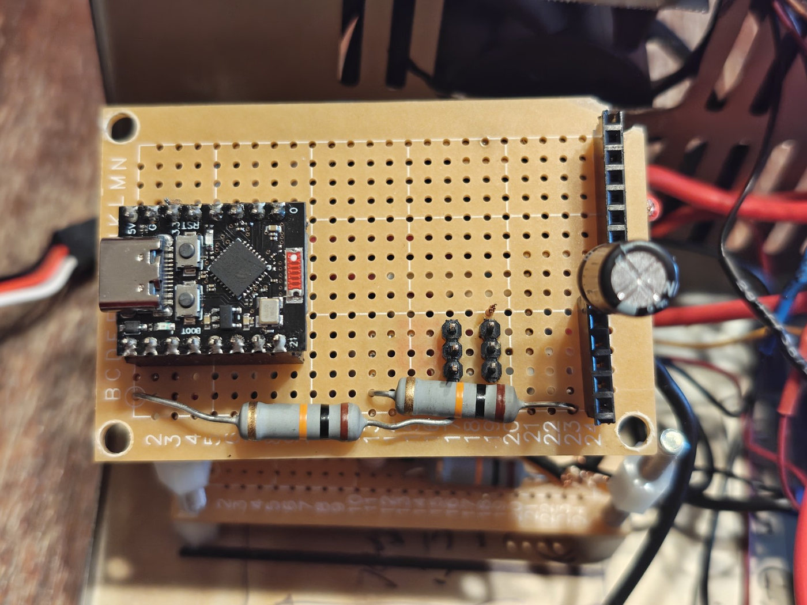 | 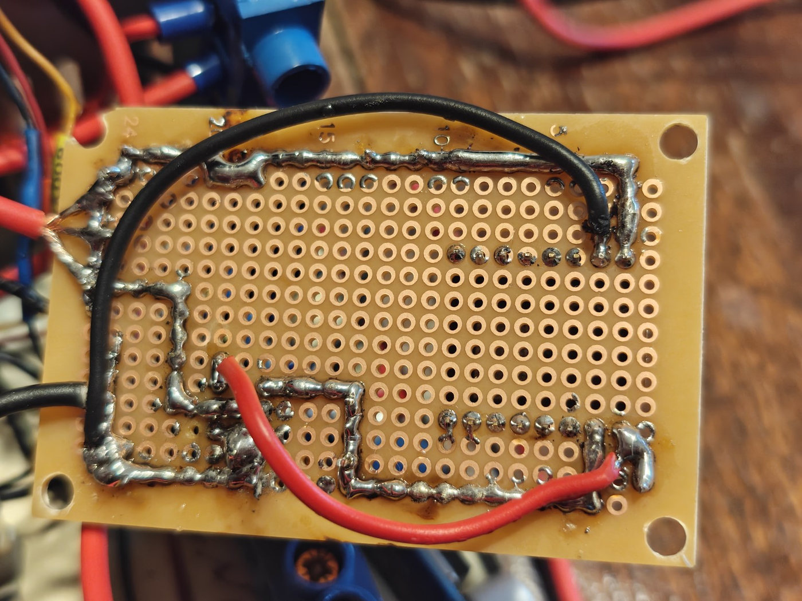 |

### Cooling node and chassis

The second ESP32 prototype explores fan PWM control and discrete driver circuitry. The chassis is still experimental, with accessible wiring, power distribution components, and active cooling hardware.

| Cooling controller | Chassis wiring and control stack |
| :---: | :---: |
| 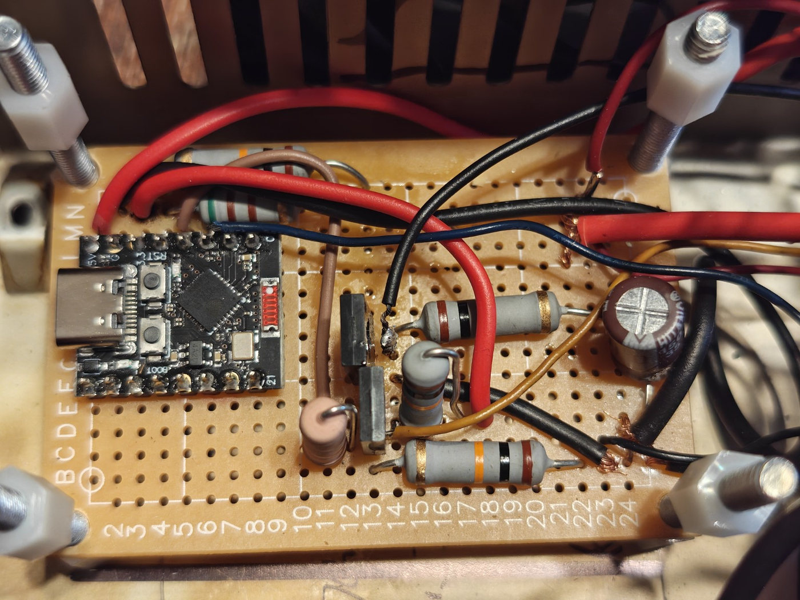 | 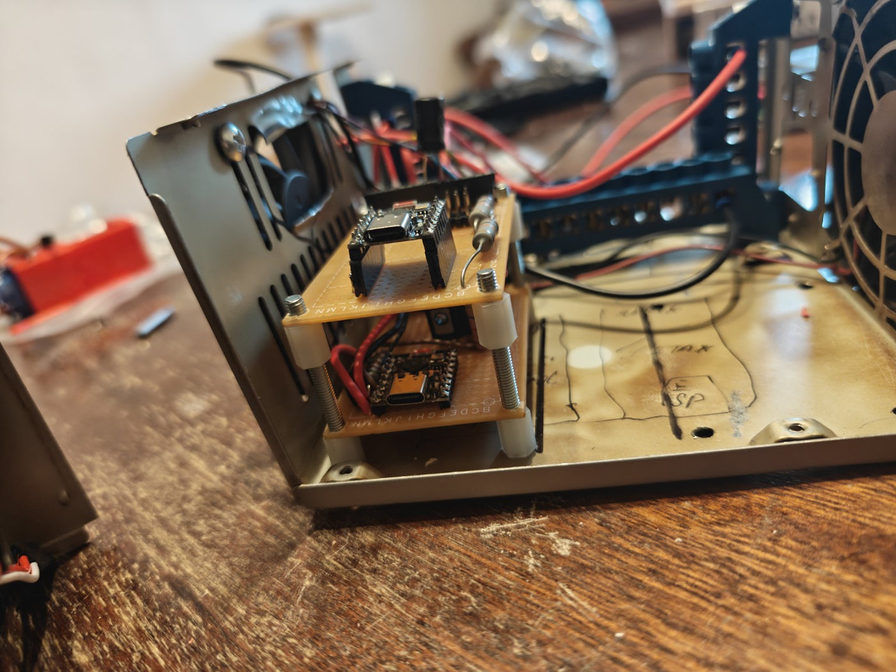 |

<details>
<summary><strong>Additional hardware photos</strong></summary>

| Servo mounting | Cooling fan |
| :---: | :---: |
| 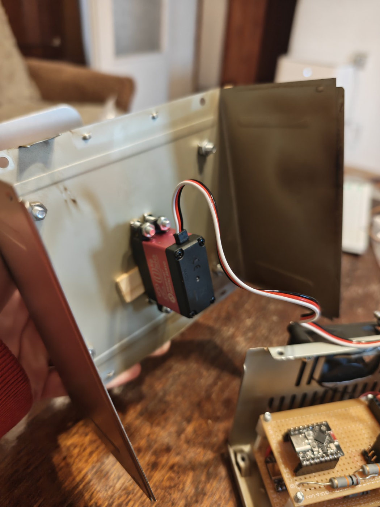 | 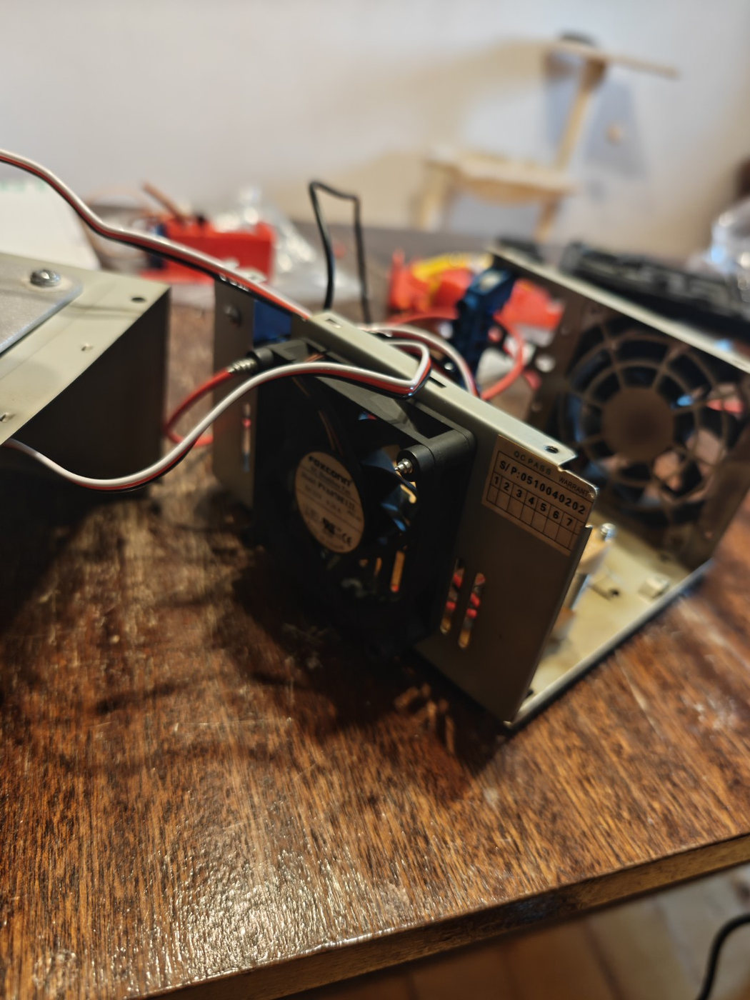 |

**Host computer:** Raspberry Pi 5 with active cooling, an NVMe SSD and a Waveshare expansion HAT.

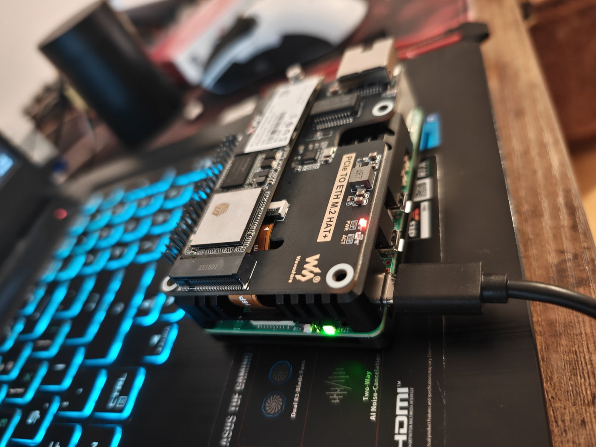

</details>

**Prototype caveat:** these are hand-built bench assemblies, not production-ready PCBs. Wiring, strain relief, insulation, power protection, mechanical limits and mounting are still being refined. The servo and cooling experiments should not be treated as a validated safety-critical system.

## Build and run

The software demo does **not** require a connected CAN interface, ESP32 or ROS 2.

### Linux ARM64 — tested on Raspberry Pi 5

Environment used: **Debian 13 (Raspberry Pi OS), GCC 14.2, CMake 3.31**.

```bash
sudo apt update
sudo apt install -y git cmake build-essential

git clone https://github.com/Anahiell/RobotProj.git
cd RobotProj

cmake -S . -B build -DCMAKE_BUILD_TYPE=Debug
cmake --build build -j4
./build/RobotProj
```

Expected beginning of the output:

```text
Platform:Linux
Architecture: ARM64
Total frames: 4

CAN ID: 0x9
Priority: 0
Node: Head
Frame Type: SequenceStart
Length: 8
Data: 01 01 00 13 00 01 02 03
```

The remaining three frames are shown in the table above.

### Windows x64 — tested with Visual Studio / CMake

Open the folder containing `CMakeLists.txt` in Visual Studio, select an x64 configuration and build/run the `RobotProj` target. The same code generates the same four-frame sequence in the Windows build.

Alternatively, from a Windows terminal with a configured C++ build toolchain:

```powershell
cmake -S . -B build
cmake --build build --config Debug
```

Executable location depends on the selected CMake generator and configuration.

## Repository layout

```text
RobotProj/
├── CMakeLists.txt
├── README.md
├── .gitignore
├── RobotProj/
│   ├── common/
│   │   ├── nodes/        # Node abstractions and models
│   │   └── protocol/     # Command framing and encoding
│   └── src/              # Application and control implementation
└── docs/
    └── media/
        ├── hardware/     # Original prototype photography, web-optimized
        └── demos/        # Servo-motion demo (MP4 + GIF preview)
```

The current executable is primarily a **protocol demonstration and integration starting point**, not a complete robot runtime.

## Engineering roadmap

- [x] Assemble initial ESP32 head and cooling hardware prototypes.
- [x] Demonstrate servo-driven neck movement.
- [x] Bring up Raspberry Pi 5 on Linux ARM64 with NVMe storage and SSH.
- [x] Build and run the C++ application on Windows x64 and Linux ARM64.
- [x] Implement and inspect Classical CAN sequence fragmentation in software.
- [ ] Add sequence reassembly, frame-order validation and malformed-frame tests.
- [ ] Introduce ACKs, timeouts, retries and bounded message handling where required.
- [ ] Connect Raspberry Pi to a physical CAN interface and integrate SocketCAN.
- [ ] Implement and validate ESP32 CAN receive/dispatch firmware.
- [ ] Add concurrent, interruptible motion handling and actuator-limit enforcement.
- [ ] Integrate ROS 2 orchestration and additional robot subsystems (eyes, arms, sensors, mobile base).

## Why this project exists

The objective is to learn and validate **systems-level robotics engineering** through a real build: C++ design, binary protocol boundaries, microcontroller firmware, Linux deployment, electrical integration, and motion hardware. The project intentionally exposes intermediate stages instead of presenting unfinished features as completed ones.

**Project status:** active development · hardware and software prototypes · no complete end-to-end autonomous operation yet.


## Development status (October 2026)

- **Implemented:** `RobotCore` static library, CMake cross-platform builds, `CommandEncoder`, stateful `CommandDecoder` (`Single`, `SequenceStart`, `SequenceData`, `SequenceEnd`), and Linux `SocketCanTransport` with socket open/close/send/receive methods.
- **Tested in CI:** GoogleTest/CTest protocol tests including signed integer round-trips, Single payload, fragmentation for payload lengths 8–1534, and Sequence encode/decode round-trips. GitHub Actions matrix: `windows-2022`, `ubuntu-24.04`, `ubuntu-24.04-arm`.
- **Not yet demonstrated:** `--can IFACE` receive loop in the CLI, SocketCAN end-to-end traffic through the application, physical Pi-to-ESP32 CAN exchange, ACK/retry/timeout policy, and deployment automation.
- **Known limitations:** the encoder currently uses a fixed sequence ID; the decoder tracks one pending sequence without a timeout; the command debug formatter uses an 8-bit loop index that can wrap for payloads of 256 bytes or more. These are tracked as GitHub Issues, not completed features.

### Task tracking

See [open GitHub Issues](https://github.com/Anahiell/RobotProj/issues) for small, independently closable tasks. Complete and test one change at a time before closing its issue. CI success confirms current tests pass; it does not imply hardware or transport integration is complete.
